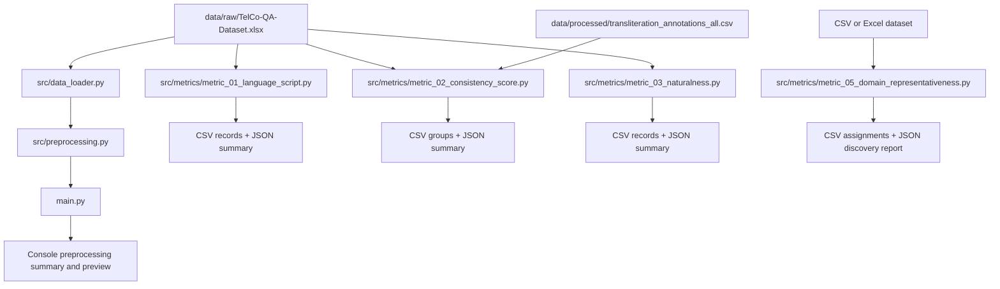

# TelCo-QA

A research-oriented framework for evaluating Telugu-English code-mixed and Romanized text datasets across independent quality dimensions. The long-term goal is to make the evaluation as dataset-independent as practical, without requiring a fixed topic taxonomy.

> **Project status:** Individual analyses exist at different levels of maturity. Metrics 1–3 have implementations, Metric 5 has an experimental unsupervised V2, and Metric 4 is deferred. The root `main.py` currently loads and preprocesses data only; it does not run or combine the metrics.

## Table of contents

- [Motivation and objectives](#motivation-and-objectives)
- [Development dataset and scope](#development-dataset-and-scope)
- [Architecture](#architecture)
- [Metric overview](#metric-overview)
  - [Metric 1: Language and Script Usage](#metric-1-language-and-script-usage)
  - [Metric 2: Transliteration Consistency](#metric-2-transliteration-consistency)
  - [Metric 3: Code-Mix Naturalness](#metric-3-code-mix-naturalness)
  - [Metric 4: Annotation Reliability](#metric-4-annotation-reliability)
  - [Metric 5: Domain Representativeness](#metric-5-domain-representativeness)
- [Outputs and report formats](#outputs-and-report-formats)
- [Installation](#installation)
- [Running the project](#running-the-project)
- [Development progress and decisions](#development-progress-and-decisions)
- [Limitations and interpretation](#limitations-and-interpretation)
- [Roadmap](#roadmap)
- [Contributing and reproducibility](#contributing-and-reproducibility)

## Motivation and objectives

TelCo-QA explores how to evaluate the quality of multilingual and code-mixed text datasets when ordinary monolingual checks or a single overall score cannot describe all relevant issues. It treats quality as several **independent dimensions** so that, for example, script consistency is not mistaken for linguistic naturalness and topic diversity is not mistaken for annotation reliability.

The project aims to:

1. Assess language and writing-system characteristics without silently treating unknown words as known.
2. Measure consistency among manually confirmed transliteration variants.
3. Inspect surface-level indicators related to code-mix naturalness.
4. Eventually measure annotation reliability using suitable annotation evidence.
5. Discover the semantic structure of a dataset without requiring its existing topic labels or a predefined topic taxonomy.
6. Generalize beyond the current Telugu-English development dataset where the method and available language resources permit.

The current implementations are research prototypes, not a unified evaluation product. Their scores and indicators should be interpreted separately and with their stated limitations.

## Development dataset and scope

The bundled development workbook is `data/raw/TelCo-QA-Dataset.xlsx`. It contains **7,223 records** and eight columns:

| Column | Role in the current project |
|---|---|
| `id` | Record identifier |
| `text` | Text analyzed by the current metrics |
| `sentiment` | Dataset metadata |
| `source` | Dataset metadata |
| `topic` | Existing topic metadata; not required by Metric 5 |
| `script` | Declared script label used by Metric 1 |
| `annotation_method` | Present but currently empty |
| `annotation_labels` | Present but currently empty |

The records include Telugu script, Romanized Telugu, English, and Telugu-English code-mixed text. The workbook currently labels its script profile as `Romanized`, `Telugu script`, or `code-mixed`. Its existing `topic` values are metadata, **not required inputs to the current Metric 5 V2 discovery engine**. Metric 5 does not use a fixed topic taxonomy or require manual domain labels.

This workbook is a **development dataset**, not the definition of all datasets TelCo-QA intends to support. Support is not yet uniform: Metric 5 accepts a CSV or Excel file and can select a text column, while Metrics 1–3 currently use project-specific paths and/or Telugu-oriented resources and assumptions. Do not infer generalization to arbitrary languages or dataset schemas from the development run.

## Architecture

### Current execution flow



The metric scripts are currently launched independently. The diagram does **not** imply that `main.py` invokes the metric modules or that their outputs are aggregated.

### Repository structure

```text
TelCo-QA/
├── README.md
├── main.py
├── requirements.txt
├── data/
│   ├── raw/
│   │   └── TelCo-QA-Dataset.xlsx
│   └── processed/                 # Metric 2 candidate, annotation, and review data
├── outputs/                       # Generated reports and existing visual snapshots
├── src/
│   ├── data_loader.py
│   ├── preprocessing.py
│   └── metrics/
│       ├── metric_01_language_script.py
│       ├── metric_02_transliteration.py
│       ├── metric_02_consistency_score.py
│       ├── metric_03_naturalness.py
│       ├── metric_05_domain_representativeness.py
│       └── supporting transliteration discovery/review/analysis scripts
└── tests/
    ├── test_naturalness.py
    └── test_transliteration.py
```

`src/data_loader.py` reads the development workbook with pandas, checks that the file exists, that it is non-empty, and that it has a `text` column. `src/preprocessing.py` copies the frame and adds `original_text`, trimmed `cleaned_text`, whitespace/lowercase `normalized_text`, and an `is_empty` flag. It preserves rows; it does not remove empty text records.

`main.py` calls that loader and preprocessor, prints record/column counts, an empty-row count, and a five-record text preview. It does not save preprocessed data or run metrics.

### Dependencies

| Dependency | Declared in `requirements.txt` | Current use / note |
|---|---:|---|
| `pandas`, `numpy`, `openpyxl` | Yes | Data frames, numerical work, and Excel input |
| `scikit-learn` | Yes | Metric 5 silhouette/vectorization and transliteration model experiments |
| `rapidfuzz` | Yes | Transliteration feature/research scripts |
| `pytest` | Yes | Test runner; current test files contain no tests |
| `matplotlib`, `seaborn` | Yes | Present in the base environment requirements; not needed by the main execution flow |
| `sentence-transformers` | **No** | Required to import/run Metric 5 and load its embedding model |
| `hdbscan` | **No** | Required by Metric 5 |
| `umap-learn` | **No** | Used by Metric 5 when installed; the code falls back to original normalized embeddings if UMAP is unavailable |

Metric 5's model may need to download from the model hub on first use. Neither its extra Python packages nor a local model cache are provisioned by `requirements.txt`. The repository does not declare a supported Python-version range.

## Metric overview

| # | Dimension | Current status | Main implementation | Inputs and outputs |
|---|---|---|---|---|
| 1 | Language and Script Usage | Implemented, V3 heuristic | Unicode script profiling, lexicon-based token identification, weighted components | Workbook with `text` and `script`; CSV record report and JSON summary |
| 2 | Transliteration Consistency | V1 implementation completed and frozen | Candidate discovery and context review, manually confirmed equivalence groups, dominant-variant share | Workbook plus reviewed pair annotations; group CSV and JSON summary |
| 3 | Code-Mix Naturalness | V1 completed and evaluated | Equal-weight lexicon/formatting heuristics | Workbook with `text`; CSV record report and JSON summary |
| 4 | Annotation Reliability | Deferred; not implemented | No reliability estimator currently exists | Annotation fields are empty in the development workbook; no metric outputs |
| 5 | Domain Representativeness | Experimental V2 semantic discovery | Multilingual embeddings, UMAP, HDBSCAN, generated descriptions, structural indicators | CSV or Excel with text; CSV assignments and JSON report |

The metrics are not yet exposed through one shared interface or common score schema. Their outputs are not interchangeable, and their component weights and interpretations differ.

### Metric 1: Language and Script Usage

**Objective.** Profile which languages and scripts are present, compare the detected writing-system profile with the dataset's declared `script` label, and report basic character support and validity indicators.

**Implemented approach (V3).**

- Tokenizes Latin-letter words and Telugu Unicode-block words.
- Identifies Telugu-script tokens directly and classifies Latin tokens through explicit Telugu-in-Latin and English word sets. Words outside those lists remain unknown; the ambiguous set is currently empty.
- Computes global language proportions per token and writing-system proportions per token.
- Independently profiles each record from the presence of Latin and Telugu Unicode characters, then compares this profile with the normalized `script` label.
- Measures supported Telugu/Latin alphabetic characters and Unicode character validity (with ZWNJ/ZWJ explicitly allowed).
- Forms a heuristic score from language-identification coverage (30%), script-label consistency (30%), script representation compatibility (20%), and Unicode validity (20%). The current quality tiers use thresholds of 80 and 60.

**Inputs.** `data/raw/TelCo-QA-Dataset.xlsx`; required columns are `text` and `script`.

**Outputs.** `outputs/metric_01_language_script_records.csv` contains per-record language proportions, script profile and label agreement, component values, score, and tier. `outputs/metric_01_language_script.json` contains aggregate distributions, mean component scores, weights, overall heuristic score/tier, and interpretation notes.

**Dependencies.** pandas, the Python standard library, and the workbook reader (`openpyxl`).

**Status and limitations.** Implemented as a standalone V3 script, but the lexicons are manually curated and Telugu-oriented. Coverage depends on vocabulary membership; the script-label comparison tests writing system, not whether the label is linguistically correct. A record containing English and Romanized Telugu is all Latin-script and cannot be identified as code-mixed by script profiling alone. The weighted score and thresholds have not been human-validated. Broader, context-sensitive language identification and validation against human judgments remain future work.

### Metric 2: Transliteration Consistency

**Objective.** Estimate whether spellings that human reviewers judge to be the same Telugu word are represented consistently within the dataset. This is a within-dataset spelling measure, not a measure of linguistic correctness.

**Research and implemented V1 approach.**

1. The exploratory `metric_02_transliteration.py` inspects common words and selected candidate pairs in Romanized/code-mixed records, retrieves sentence contexts, and proposes repeated-vowel variants. Automatic suggestions are not treated as confirmed equivalences.
2. `discover_all_transliteration_candidates.py` selects Romanized and code-mixed rows, counts Latin words occurring at least five times, and compares eligible word pairs. It suggests pairs using repeated-vowel collapse and broad `dh`→`d` / `th`→`t` normalization, or character similarity (SequenceMatcher ratio at least 0.78, with a maximum length difference of two). It retains example contexts and labels candidates for review.
3. Candidate pairs are manually annotated. The scoring implementation consumes `word_1`, `word_2`, and `annotation`; only `SAME`/`1` decisions are unioned into equivalence groups.
4. It counts lowercase `[a-z]+` occurrences from the dataset text. A group is scored only when at least two confirmed spellings occur. Its score is the dominant spelling's frequency divided by the group's total frequency; the overall score is the dominant count summed across measurable groups divided by all their occurrences.

**V1 status.** The scoring implementation is completed and frozen. Candidate discovery, context inspection, annotation, grouping, and model-analysis files remain in the repository as supporting research workflow; the experimental classifiers are not the deployed scoring method.

**Inputs.** The development Excel workbook and `data/processed/transliteration_annotations_all.csv` (manually reviewed pair annotations).

**Outputs.** `data/processed/transliteration_consistency_groups.csv` contains measurable group-level results, including observed variants, counts, dominant spelling, and group score. `outputs/metric_02_consistency_score.json` contains the overall score, occurrence/group counts, method, and interpretation.

**Dependencies.** pandas, the workbook reader, Python standard library; supporting feature/model experiments also use `rapidfuzz` and scikit-learn.

**Limitations and future work.** Candidate normalization and string similarity can suggest unrelated words; human context review is essential. The score depends on the coverage and correctness of manually annotated equivalence groups. It uses lowercased Latin-only token matching and does not model context, morphology, transliteration dialects, or Telugu-script equivalents. The frozen V1 is not currently a universal transliteration evaluator; any change to the metric itself belongs in a separately versioned revision.

### Metric 3: Code-Mix Naturalness

**Objective.** Report heuristic signals related to readable code-mixed text: language-identification coverage, local switching patterns, within-token script compatibility, adjacent repetition, and basic formatting.

**Implemented approach (V1).** A hand-built tokenizer and Telugu/English vocabularies classify Telugu-script, Romanized Telugu, English, ambiguous, unknown, mixed-script, number, and punctuation tokens. The five components are equally weighted:

- **Language identification coverage:** share of alphabetic-language tokens classified as Telugu, English, or mixed.
- **Switching stability:** penalizes patterns that alternate A–B–A in a run of three recognized language labels. Unknown, ambiguous, and mixed tokens split runs.
- **Script compatibility:** penalizes whitespace-delimited units that contain both Telugu Unicode and Latin letters; switching scripts between words is allowed.
- **Repetition:** penalizes consecutive repeated word tokens.
- **Text structure:** applies fixed penalties for repeated whitespace, spaces before punctuation, repeated punctuation, and missing separation after punctuation.

The overall score is the mean of those components. A monolingual Telugu or English record is allowed to score highly; bilingual composition is not mandatory. Empty text receives no score and is reported as not evaluated.

**Inputs.** `data/raw/TelCo-QA-Dataset.xlsx`; required column: `text`.

**Outputs.** `outputs/metric_03_naturalness_records.csv` adds per-record components, score, tier, token statistics, and unknown words to the input rows. `outputs/metric_03_naturalness.json` contains aggregate scores, tier counts, language statistics, frequent unknown tokens, method, and limitations.

**Dependencies.** pandas, the workbook reader, and Python standard library.

**Status and limitations.** V1 is implemented and has a stored evaluation report. It is an exploratory heuristic rather than a human-validated measure: it does not assess grammar, meaning, or semantic coherence; vocabulary coverage is incomplete; the A–B–A rule is only a simplified stability proxy; and fixed component weights/tier thresholds are provisional. “Naturalness” should not be read as a validated linguistic judgment.

### Metric 4: Annotation Reliability

**Objective.** Measure the reliability and consistency of dataset annotations, using appropriate evidence such as multiple annotators' labels, agreement, adjudication, and annotation-method metadata.

**Current status.** Deferred until Metric 5 is sufficiently developed. No Metric 4 implementation, agreed estimator, module, or report currently exists. The development workbook's `annotation_method` and `annotation_labels` columns are present but empty, so they cannot support reliability estimation in the current dataset.

**Inputs, outputs, and dependencies.** The intended inputs, statistic(s), handling of missing/uneven annotator assignments, output schema, and dependencies are not yet specified in code. These must be designed and validated against annotated data before a reliability score is reported.

**Limitations and planned work.** Reliability cannot be inferred from empty annotation fields or from the existence of a single label column. Future implementation must distinguish agreement from annotation validity and select statistics appropriate to the number/type of annotators and labels. It should include validation data and documented assumptions.

### Metric 5: Domain Representativeness

**Objective.** Describe the semantic subject-matter structure found within a dataset and how records are distributed over discovered groups. In the current V2 implementation, “representativeness” is a planned dimension name; the computed indicators describe **within-dataset structure**, not match to an external target population.

**Evolution.**

- **Earlier V1:** the available `metric_05_domain_representativeness.json` records a content-based approach with a predefined set of labels (including Sports, Food and Lifestyle, News and Current Affairs, Entertainment, Education, Technology, Politics, Environment, Health, Other, and Unknown/Unclassified), cluster details, weighted component scores, and an overall grade. This taxonomy-dependent report is retained as a legacy artifact.
- **Current V2:** `metric_05_domain_representativeness.py` replaces fixed categories with unsupervised semantic group discovery. It does not consume the workbook's `topic` column, use a predefined domain taxonomy, or require manual domain labels. Automatically generated descriptions are keywords, not verified labels.

**V2 implementation details.**

1. Loads CSV or Excel data and selects a requested text column, a conventional text-column name, or—if none is found—the column with the greatest average non-empty text length.
2. Preserves source rows and text content apart from whitespace normalization. Empty text rows are excluded from embedding/clustering but retained in the record-level output.
3. Encodes each record with `intfloat/multilingual-e5-base`, adding the `query: ` prefix and requesting normalized embeddings in batches of 32.
4. Reduces embeddings with UMAP when the package is installed: cosine metric, up to 15 neighbors, up to five components, `min_dist=0`, and a fixed random seed. If `umap-learn` is absent, it falls back to the normalized embeddings.
5. Clusters the reduced representation with HDBSCAN using Euclidean distance and the `eom` selection method. `min_cluster_size` is derived from the square root of the evaluated dataset size and clipped to 10–50; `min_samples` is approximately one quarter of that size, with a minimum of two. HDBSCAN label `-1` denotes unassigned/noise records.
6. Builds group descriptions from cluster text with CountVectorizer unigrams and bigrams and an English stop-word list. It weights terms using a class-based TF-IDF-style calculation across cluster documents. For each group it also reports record count, mean cosine similarity to a normalized group centroid, and up to three centroid-nearest representative texts.
7. Reports discovery coverage, unassigned count, group-size distribution, Shannon and normalized entropy, effective group count (`exp(entropy)`), largest group share, Herfindahl concentration, mean group cohesion, and cosine silhouette. Silhouette uses assigned records and samples up to 2,000 records.

**Latest available V2 experiment.** The checked-in `outputs/metric_05_domain_discovery.json` reports the following snapshot for the 7,223-record development dataset:

| Indicator | Reported value |
|---|---:|
| Semantic groups discovered | 73 |
| Unassigned records | 936 |
| Discovery coverage | 87.04% |
| Normalized entropy | 0.9085 |
| Effective group count | 49.3 |
| Largest group share | 0.1942 |
| Mean group cohesion | 0.959 |
| Cosine silhouette | 0.2111 |

These are **experimental structural measurements, not validated dataset-quality scores**. In particular, discovery coverage is not a measure of representativeness.

**Inputs.** CSV or Excel with a usable text column. The default is the development workbook and `text`; `--text-column` can override automatic selection. The bundled dataset's `topic` field is not used by V2.

**Outputs.** `outputs/metric_05_domain_discovery_records.csv` retains input columns and adds processed text, `semantic_group_id`, `cluster_strength`, and generated group description. `outputs/metric_05_domain_discovery.json` stores the model/method configuration, dataset counts, group distribution indicators, per-group descriptions/statistics/representative records, and limitations.

**Dependencies.** pandas, numpy, sentence-transformers, hdbscan, and scikit-learn are required by the current module; umap-learn is used for dimensionality reduction when installed. `sentence-transformers`, `hdbscan`, and `umap-learn` are not declared in the current `requirements.txt`; see [Installation](#installation).

**Known limitations and planned improvement.**

- Some groups are excessively fine-grained; semantically related subgroups may need a hierarchical organization.
- Telugu-script cluster descriptions may yield meaningless character-level terms with the current vectorizer/tokenization.
- High centroid cohesion does not guarantee useful separation between groups. The reported cosine silhouette is a distinct separation indicator and should be interpreted alongside inspection.
- Multilingual embeddings may behave unevenly across Telugu script, Romanized Telugu, dialects, short text, and code-mixing.
- HDBSCAN results depend on the embedding model, UMAP representation, and cluster parameters; unassigned records can have several causes.
- Discovery coverage only indicates the fraction assigned by this run. Without a known target distribution or a defined population sampling frame, these results cannot establish real-world representativeness.
- Generated keyword descriptions and representative examples require human review. V2 intentionally does not issue a universal quality grade.

## Outputs and report formats

| Metric | File | Format and contents |
|---|---|---|
| 1 | `outputs/metric_01_language_script_records.csv` | Per-record script profiles, component values, score and tier |
| 1 | `outputs/metric_01_language_script.json` | Aggregate distributions, component scores, weights, interpretation notes |
| 2 | `data/processed/transliteration_consistency_groups.csv` | Confirmed equivalence-group frequencies and consistency scores |
| 2 | `outputs/metric_02_consistency_score.json` | Overall score, occurrence/group counts, method and interpretation |
| 3 | `outputs/metric_03_naturalness_records.csv` | Input records plus per-record naturalness components, score, and token details |
| 3 | `outputs/metric_03_naturalness.json` | Aggregate component scores, tiers, token statistics, and limitations |
| 5 V2 | `outputs/metric_05_domain_discovery_records.csv` | Input records plus semantic assignment, strength, and generated description |
| 5 V2 | `outputs/metric_05_domain_discovery.json` | Discovery statistics and per-group summaries, terms, and representative texts |

The V2 Metric 5 code writes CSV with UTF-8 BOM (`utf-8-sig`) and JSON as UTF-8. Metric 5's JSON includes representative text, so treat it as data-bearing output. `outputs/metric_05_domain_representativeness.json` and the similarly named CSV are legacy V1 artifacts, not V2 output paths. Existing JPEG files in `outputs/` are visual snapshots; the current metric scripts do not generate those images as part of their documented output flow.

Metric 2 also has a broader supporting workflow under `src/metrics/` and `data/processed/` for candidate discovery, annotation batches, review, feature extraction, grouped data, model comparisons, and out-of-fold predictions. These intermediate CSVs are research artifacts, not outputs of the frozen Metric 2 score command.

## Installation

Run these commands in **Windows PowerShell** from the directory where you want the repository:

```powershell
git clone https://github.com/BanuTejaChalla/TelCo-QA.git
Set-Location .\TelCo-QA

py -m venv .venv
Set-ExecutionPolicy -Scope Process -ExecutionPolicy Bypass
.\.venv\Scripts\Activate.ps1

python -m pip install --upgrade pip
python -m pip install -r requirements.txt
```

The execution-policy command applies only to the current PowerShell process. If script activation is already allowed, it is not necessary.

To run Metric 5, install its dependencies separately because they are not in the base requirements:

```powershell
python -m pip install sentence-transformers umap-learn hdbscan
```

The model `intfloat/multilingual-e5-base` may be downloaded the first time Metric 5 runs. The repository does not currently pin dependency versions or define a lock file, so an exact reproducible environment is not yet specified.

## Running the project

From the repository root, with the virtual environment active:

### Main preprocessing flow

```powershell
python main.py
```

This loads the default workbook, adds preprocessing columns in memory, and prints a summary and preview. It does **not** execute the metrics or write a unified report.

### Run individual metrics

```powershell
python -m src.metrics.metric_01_language_script
python -m src.metrics.metric_02_consistency_score
python -m src.metrics.metric_03_naturalness
python -m src.metrics.metric_05_domain_representativeness
```

Metric 2 requires both the default workbook and `data/processed/transliteration_annotations_all.csv`. Metric 5's default dataset is the bundled workbook; a custom CSV or Excel dataset and text-column name can be supplied:

```powershell
python -m src.metrics.metric_05_domain_representativeness "C:\data\my_dataset.csv" --text-column message
```

Metric 5's positional dataset argument accepts CSV and Excel (`.xlsx`/`.xls`) files. The Metric 1–3 commands currently use their configured project data paths rather than a general input-file CLI.

To run the transliteration candidate discovery research script (separate from the frozen score calculation):

```powershell
python -m src.metrics.discover_all_transliteration_candidates
```

It uses the bundled dataset and writes candidate suggestions to `data/processed/transliteration_all_candidates.csv`; suggestions need context review and annotation before they are treated as equivalences.

### Tests

```powershell
python -m pytest -q
```

The repository currently has `tests/test_naturalness.py` and `tests/test_transliteration.py`, but both files are empty. Pytest therefore reports **no tests ran** and exits with its no-tests-collected status; this command currently provides no behavioral validation.

## Development progress and decisions

| Area | Progress | Decision / next step |
|---|---|---|
| Data loading and preprocessing | Implemented | Preserve all rows and original text; add cleaned/normalized columns in memory |
| Metric 1 | V3 standalone heuristic implemented | Keep unknown tokens explicit; improve language identification and validate scoring |
| Metric 2 | V1 completed and frozen | Separate candidate suggestion from human confirmation; use confirmed groups for scoring |
| Metric 2 research workflow | Candidate discovery, annotations/review, features, and model comparison artifacts exist | Experimental classifiers are not used by the frozen production scoring path |
| Metric 3 | V1 implemented and evaluated | Retain monolingual eligibility; label the result heuristic rather than validated naturalness |
| Metric 4 | Deferred | Wait for Metric 5 maturity and suitable non-empty annotation evidence |
| Metric 5 V1 | Legacy taxonomy-based report exists | Fixed topic labels were insufficient for dataset-independent discovery |
| Metric 5 V2 | Experimental unsupervised semantic discovery implemented and run | Discover groups without supplied topic labels; improve granularity, hierarchy, descriptions, and validation |
| Orchestration/reporting | Not implemented | Integrate metrics via `main.py` and a master aggregation engine |
| Tests | Test filenames exist, contents are empty | Add focused metric and end-to-end validation procedures |
| Dashboard | Not implemented | Planned Streamlit interface and user-selectable report formats |

Important current architectural choices are to keep the five dimensions independent, to preserve source records during preprocessing, to require manual confirmation before transliteration pairs affect Metric 2, and to avoid claiming that unsupervised group discovery demonstrates population representativeness.

## Limitations and interpretation

- The repository is a set of standalone metric prototypes, not yet an end-to-end quality evaluation service.
- Metrics 1–3 contain Telugu-specific lexicons, rules, fixed paths, or schema expectations. Metric 5 is more input-flexible, but multilingual coverage still needs validation.
- Metric scores are heuristic or experimental. The currently stored reports are outputs of particular runs, not evidence of validated accuracy or general quality.
- Metric 5 measures internal grouping and distribution structure. No target-population distribution, sampling frame, or external reference distribution is supplied.
- The checked-in tests are empty; no regression or end-to-end test suite currently guards expected behavior.
- Requirements are unpinned, Metric 5 dependencies are omitted from the base manifest, and there is no documented seed/data/model version bundle beyond settings present in code.
- Existing output artifacts may be stale relative to current source or data. In particular, the V1 Metric 5 report is not the V2 discovery report.

## Roadmap

The following are planned development stages, not completed features:

1. Improve and validate Metric 5's multilingual semantic discovery and hierarchical grouping.
2. Implement Metric 4: Annotation Reliability.
3. Review and refine all five independent metrics.
4. Standardize metric interfaces and output schemas.
5. Integrate all metrics through `main.py` and a master aggregation engine.
6. Develop a unified dataset quality evaluation report.
7. Implement a Streamlit dashboard with visualizations and user-selectable output formats.
8. Add validation datasets and evaluation procedures.
9. Improve documentation, testing, reproducibility, and generalization to unfamiliar datasets.

## Contributing and reproducibility

When extending a metric, document its version, inputs, outputs, assumptions, and limitations; keep experimental indicators distinct from validated measurements; and add focused tests for behavior that is introduced or changed. For Metric 5, record the embedding model, clustering settings, and relevant environment versions when comparing runs. Do not use existing `topic` labels as a hidden requirement for V2 domain discovery.

Before sharing generated reports, review them for record text and other dataset content. The Metric 5 report includes representative examples from input records.

## Development Changelog

| Date | Component | Version | Update |
|---|---|---|---|
| 2026-11-20 | Metric 5 | V2 | Implemented unsupervised semantic discovery using multilingual sentence embeddings, UMAP, and HDBSCAN. |
| 2026-11-20 | Metric 5 | V2 Evaluation | Processed 7,223 records, discovering 73 semantic groups with 87.04% discovery coverage. Identified issues with fine-grained clustering and Telugu-script cluster descriptions. |
| TBD | Metric 5 | V3 | Planned improvements to multilingual cluster descriptions, hierarchical grouping, and cluster validation. |

*Update this table whenever a significant implementation, experiment, architectural decision, or evaluation is completed. Record experimental failures and replaced approaches as well as successful changes.*